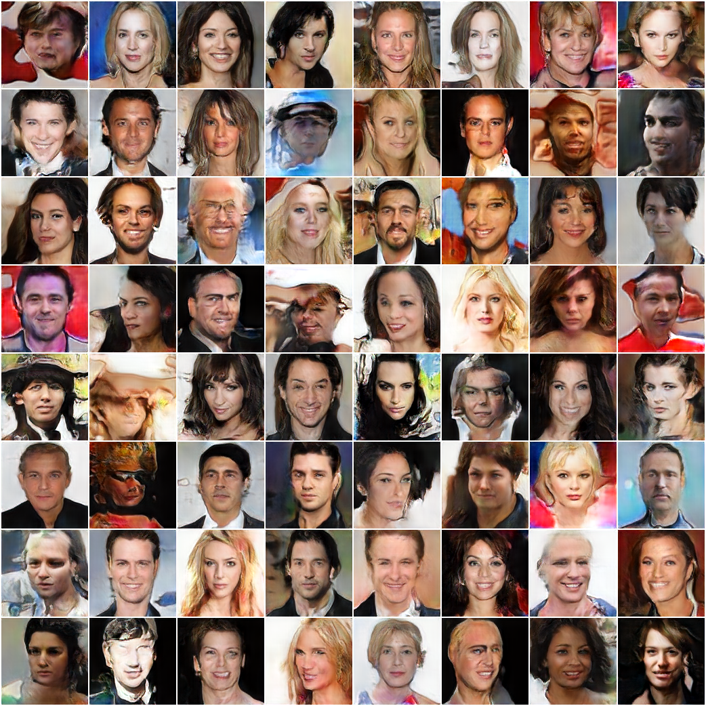
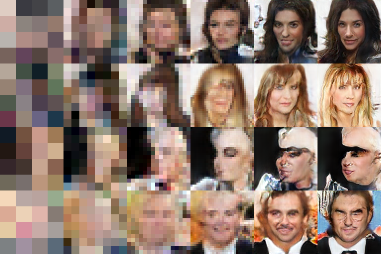
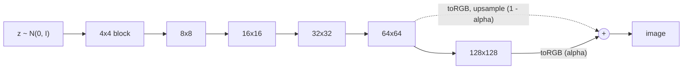
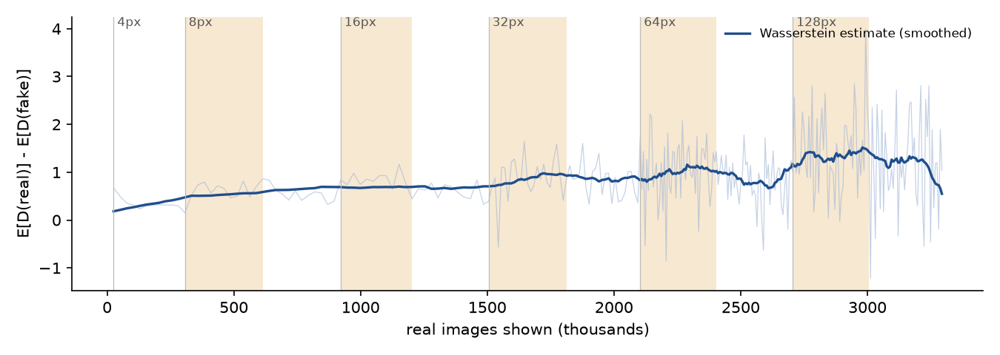

# progan

[](https://github.com/jobarber/progan/actions/workflows/ci.yml)

A from-scratch PyTorch implementation of progressive growing of GANs
([Karras et al., 2018](https://arxiv.org/abs/1710.10196)), trained on CelebA up to 128x128
on a single laptop GPU.



*Uncurated samples from the EMA generator after 3.3M real images. FID 63.1 against the training
set (10k samples). The paper's runs see several times more images per resolution, so expect
sharper faces from a longer schedule.*

## How the network grows

Training starts at 4x4. Each new resolution is faded in: the new block's output is blended
with an upsampled copy of the previous stage's output while `alpha` ramps from 0 to 1, then the
network trains at that resolution until the next fade. The same four latents, rendered at the end of
each stage:






## What is implemented

| Paper component | Where |
|---|---|
| Equalized learning rate (weights stored as N(0, 1), He-scaled at runtime) | `layers.py` |
| Pixelwise feature normalization in the generator | `layers.py` |
| Minibatch standard deviation layer | `layers.py` |
| Smooth fade-in of new resolution blocks, in G and D | `models.py` |
| WGAN-GP loss with the drift term | `losses.py` |
| EMA of generator weights for sampling | `train.py` |
| Real images blended between resolutions during each fade, matching the generator | `data.py` |
| Fresh Adam state at each resolution (from the official code) | `train.py` |

Design choices that differ from a literal port:

- **All blocks are built up front.** `forward(z, stage, alpha)` picks how many are active. Checkpoints are
  plain state dicts, and resuming is just loading a file.
  The 2020 version of this repo grew modules dynamically and pickled whole models.
- **Images are cached once as a uint8 memmap** at full resolution and downsampled on the GPU per stage,
  which removes JPEG decoding from the training loop.
- **Narrower feature maps at high resolution** (`fmap_base=4096`) to fit a laptop budget. This trades some
  quality for roughly 2x throughput at 64x64 and above.

## Training curve



Shaded regions are fade-ins. The estimate stays in a narrow band throughout; it gets noisier at 64x64
and 128x128, where the batch drops to 32. A checkpoint is saved at the end of every resolution.

## Quick start

```bash
uv sync --extra cu128 --extra data --extra eval   # or --extra cpu
uv run progan prepare                              # 50k CelebA faces -> data/celeba128.npy (2.5 GB)
uv run progan train --data data/celeba128.npy --fmap-base 4096 --fade-kimg 300 --stable-kimg 300
uv run progan sample --checkpoint runs/celeba128/generator_ema.pt
uv run progan interpolate --checkpoint runs/celeba128/generator_ema.pt
uv run progan fid --checkpoint runs/celeba128/generator_ema.pt --data data/celeba128.npy
```

Training is resumable: rerunning `progan train` with the same `--out-dir` continues from the last
checkpoint. Any folder of images works via `progan prepare --folder path/to/images`.

The run above took about 2.7 hours of training on an RTX 4080 Laptop GPU (12 GB).

## Tests

```bash
uv run pytest
```

The tests check the properties that make progressive growing work, not just shapes. At `alpha = 0`,
the generator's output equals the upsampled output of the previous stage, and the discriminator's score
equals its score on the downsampled image. Inactive blocks receive no gradient. The gradient penalty
is zero for a critic with unit-norm gradients. An end-to-end run trains a tiny model from 4x4 to 16x16
on CPU, reloads it, and confirms that resuming a finished run is a no-op.

## Layout

```
src/progan/
  layers.py    equalized conv/linear, PixelNorm, MinibatchStd
  models.py    Generator, Discriminator
  losses.py    WGAN-GP + drift
  data.py      uint8 image cache, GPU downsampling
  train.py     schedule, training loop, EMA, checkpoints
  sample.py    grids, interpolation GIFs, FID, plots
  cli.py       `progan` command
```
